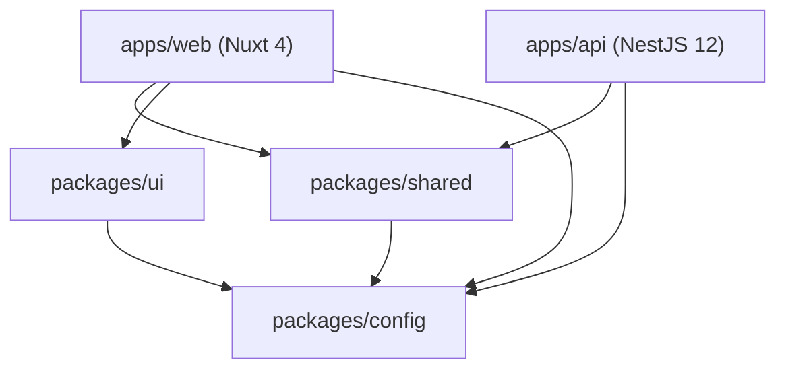

# Architecture & Monorepo Structure

This document outlines the monorepo design, package dependency rules, web application layering, and API modular architecture for the Serag platform.

---

## 1. Monorepo Layout & Dependency Graph

Serag is organized as a pnpm workspace with task caching managed by Turborepo (`turbo.json`).

```text
mohamedserag_ecommerce/
├── apps/
│   ├── web/                    # Nuxt 4 application (Storefront + /admin)
│   └── api/                    # NestJS 12 application (+ Prisma 7 schema & migrations)
├── packages/
│   ├── shared/                 # Domain logic, normalizers, money, enums, WhatsApp, Zod schemas
│   ├── ui/                     # Brand CSS tokens (@theme) and TypeScript palette constants
│   └── config/                 # Shared tsconfig bases and ESLint flat configuration
├── tests/
│   └── e2e/                    # TesterArmy browser e2e runner configuration and test suites
├── docker/                     # compose.dev.yml, compose.yml, compose.e2e.yml, Caddyfile
└── prototype/                  # Original HTML prototype (frozen reference for design & catalog)
```

### Dependency Rules

The dependency flow is strictly unidirectional:
- **`apps/*` may depend on `packages/*`**.
- **`packages/*` must NEVER depend on `apps/*`**.
- **No circular dependencies between packages**.
- **`packages/shared` has ZERO framework dependencies**: It contains only pure TypeScript and `zod` (`catalog:`). It must never import Vue, Nuxt, NestJS, React, Express, or Prisma.
- **`packages/ui` contains brand styles and tokens only**: CSS-first tokens in `tokens.css` and type constants in `tokens.ts`.
- **`packages/config` provides tooling presets**: ESLint flat config and TypeScript bases consumed via `workspace:*`.



---

## 2. Web Application Layering (`apps/web/app`)

The web storefront and admin portal live together in `apps/web/app` following a strict layer hierarchy:

```text
apps/web/app/
├── app.vue                     # Global shell, head tags, direction, and toast container
├── pages/                      # Routing entry points: route, meta, composition only
│   ├── index.vue               # Storefront home
│   └── admin/                  # /admin routes (layout: admin, middleware: admin-auth)
│       ├── index.vue           # Admin dashboard overview
│       └── login.vue           # Admin login page (layout: false)
├── layouts/                    # Structural view layouts
│   ├── default.vue             # Storefront layout (header, main content slot, footer, bottom nav)
│   └── admin.vue               # Admin portal layout (desktop sidebar, mobile sheet, topbar)
├── components/                 # Vue UI components grouped by domain and area
│   ├── store/                  # Storefront components
│   │   ├── StoreHeader.vue     # Store header coordinator
│   │   ├── StoreFooter.vue     # Store footer
│   │   ├── StoreBottomNav.vue  # Mobile bottom navigation
│   │   └── header/             # Header subcomponents (StoreHeaderAnnouncement, etc.)
│   ├── admin/                  # Admin portal components
│   │   ├── AdminSidebar.vue    # Admin sidebar navigation
│   │   ├── AdminTopbar.vue     # Admin topbar with breadcrumb & actions
│   │   ├── sidebar/            # Sidebar subcomponents (AdminSidebarBrand, etc.)
│   │   ├── login/              # Login subcomponents (AdminLoginForm, etc.)
│   │   └── dashboard/          # Dashboard subcomponents (AdminDashboardWelcomeHeader, etc.)
│   ├── form/                   # Shared form wrappers (FormField, FormPasswordInput, FormAlert)
│   ├── common/                 # Generic shared widgets (LocaleSwitcher)
│   └── ui/                     # shadcn-vue generated primitives (Button, Card, Input, Sheet, etc.)
├── composables/                # Stateful, Nuxt-aware reactive logic
│   ├── useAdminAuth.ts         # Admin authentication actions (login, logout, fetchMe, can)
│   ├── useAdminSession.ts      # Shared reactive session state (useState)
│   ├── useLoginForm.ts         # Login form state, validation, and submission
│   ├── useAdminShortcuts.ts    # Global keydown listener for admin navigation chords
│   ├── useAdminRouteTitleSync.ts # Syncs route title with topbar
│   ├── useStoreSettings.ts     # Store configuration and contact numbers
│   ├── useHeaderBadges.ts      # Header cart, wishlist, and compare counters
│   ├── useNavActive.ts         # Active route checking for navigation items
│   └── useAnalytics.ts         # Client-side Umami funnel event tracking
├── utils/                      # Pure, framework-agnostic utility functions (unit-tested)
│   ├── api.ts                  # API base resolution, SSR cookie forwarding, status parsing
│   ├── auth.ts                 # Safe next-path redirect resolution, email validation, error keys
│   ├── shortcuts.ts            # Admin shortcut sequence state machine and key tracker
│   ├── i18n.ts                 # Pure locale string utilities (stripLocalePrefix)
│   └── analytics-queue.ts      # In-memory queue buffering analytics events before script loads
├── constants/                  # Pure static configurations and link lists
│   └── navigation.ts           # STORE_NAV_ITEMS, FOOTER_LINKS, FOOTER_STORE_SECTIONS
├── types/                      # Application TypeScript interfaces
│   └── admin.ts                # AdminUser, AdminAuthPayload
├── middleware/                 # Nuxt route middleware
│   └── admin-auth.ts           # Route guard verifying admin session and redirecting to login
├── lib/                        # Low-level helper libraries
│   └── utils.ts                # Tailwind class merge helper cn()
└── assets/                     # Styles and static assets
    └── css/main.css            # Tailwind 4 stylesheet importing @serag/ui/tokens.css
```

### Layer Rules:
- **`pages/` are thin**: Pages must NOT fetch directly with raw `$fetch`, contain inline validation logic, or manage complex local state. They define layout, declare middleware, set `useSeoMeta()`, and compose domain components.
- **`components/ui/` is untouched**: Primitive components in `components/ui/` are generated by `shadcn-vue`. Do not edit them directly. Custom styling and extensions belong in wrapper components (e.g. `components/form/FormPasswordInput.vue`).
- **`composables/` vs `utils/`**:
  - `composables/`: Stateful, may call Nuxt lifecycle hooks (`onMounted`, `useState`, `useI18n`, `useRuntimeConfig`, `useRoute`).
  - `utils/`: Pure functions with zero side effects. Given the same inputs, they return the same outputs. Every utility must have a corresponding `.test.ts` file in `apps/web/test/`.

---

## 3. Admin Authentication Data Flow

Admin authentication uses httpOnly session cookies and CSRF tokens for state-modifying requests:

```text
┌────────────────────────────────────────────────────────────────────────┐
│                        apps/web (Nuxt 4 Client & SSR)                  │
│                                                                        │
│   ┌────────────────────────────────────────────────────────────────┐   │
│   │                      useAdminSession()                         │   │
│   │   useState('admin:user')                                       │   │
│   │   useState('admin:permissions')                                │   │
│   │   useState('admin:csrfToken')                                  │   │
│   └──────────────────────────────▲─────────────────────────────────┘   │
│                                  │ reads / writes reactive state       │
│   ┌──────────────────────────────┴─────────────────────────────────┐   │
│   │                       useAdminAuth()                           │   │
│   │   login(email, pass) / logout() / fetchMe() / can(perm)        │   │
│   └──────────────────────────────┬─────────────────────────────────┘   │
│                                  │ calls HTTP with credentials         │
│   ┌──────────────────────────────▼─────────────────────────────────┐   │
│   │           buildRequestHeaders() + getApiBaseUrl()              │   │
│   │   - Resolves SSR base vs client base                           │   │
│   │   - Forwards cookie header during SSR (useRequestHeaders)      │   │
│   │   - Injects x-csrf-token on mutations (POST/PUT/PATCH/DELETE)  │   │
│   └──────────────────────────────┬─────────────────────────────────┘   │
└──────────────────────────────────┼─────────────────────────────────────┘
                                   │ HTTP Request (credentials: include)
                                   ▼
┌────────────────────────────────────────────────────────────────────────┐
│                          apps/api (NestJS 12)                          │
│                                                                        │
│   ┌────────────────────────────────────────────────────────────────┐   │
│   │                    SessionGuard (Global Guard)                 │   │
│   │   - Checks route matches admin prefix                          │   │
│   │   - Reads & SHA-256 hashes serag_sid cookie                    │   │
│   │   - Verifies session exists, is unexpired, and user active     │   │
│   │   - Verifies x-csrf-token on mutations                         │   │
│   │   - Auto-extends session TTL if threshold passed               │   │
│   └──────────────────────────────┬─────────────────────────────────┘   │
│                                  │ sets req.admin context              │
│   ┌──────────────────────────────▼─────────────────────────────────┐   │
│   │                  PermissionGuard (Global Guard)                │   │
│   │   - Fail-closed: requires @RequirePermission or @AnyAdmin      │   │
│   │   - Asserts admin.permissions has required permission keys     │   │
│   └──────────────────────────────┬─────────────────────────────────┘   │
│                                  │ delegates to controller             │
│   ┌──────────────────────────────▼─────────────────────────────────┐   │
│   │                 AuthController & AuthService                   │   │
│   │   - /api/admin/auth/login -> verifies Argon2 password          │   │
│   │   - /api/admin/auth/me    -> returns user, perms & csrfToken   │   │
│   │   - /api/admin/auth/logout-> clears session & cookie           │   │
│   └────────────────────────────────────────────────────────────────┘   │
└────────────────────────────────────────────────────────────────────────┘
```

---

## 4. API Module Architecture (`apps/api/src`)

The NestJS backend organizes features into cohesive modules. Every domain module follows a consistent layout:

```text
apps/api/src/<domain>/
├── <domain>.module.ts          # Module definition, imports, controllers, providers, exports
├── <domain>.controller.ts      # Route handlers, HTTP status codes, Swagger/OpenAPI annotations
├── <domain>.service.ts         # Business logic, Prisma database operations, transactions
├── <domain>.dto.ts             # Input schemas, Zod validation definitions, TypeScript types
├── <domain>.guard.ts           # Domain-specific guards (if applicable)
└── <domain>.spec.ts            # Unit tests for the service (mocking PrismaService)
```

### Existing Modules:
- **`auth/`**: Admin session authentication, Argon2 verification, `@RequirePermission` and `@AnyAdmin` decorators, `SessionGuard`, `PermissionGuard`.
- **`audit/`**: `AuditInterceptor` recording admin mutations (POST/PUT/PATCH/DELETE) into `AuditLog` table with truncated `after` snapshot (max 20 KB).
- **`test-seed/`**: Test seed module (`TestSeedModule.forRoot()`) registering endpoints (`/api/test/seed/*`, `/api/test/reset`) strictly when `ALLOW_TEST_SEED=true` and `TEST_SEED_SECRET` >= 16 chars.
- **`prisma/`**: `PrismaModule` and `PrismaService` managing database connection lifecycle via `@prisma/adapter-pg`.

### Planned Modules (Slices 1–7):
- **`catalog/`** (Slice 1): Products, categories, brands, spec templates, filters.
- **`search/`** (Slice 1): Arabic trigram similarity search on `searchText` and synonyms.
- **`cart/` & `orders/`** (Slice 2): Cart quote, order creation, order state machine, stock movements.
- **`payments/`** (Slice 2): Payment confirmation, partial payments, large-COD deposits.
- **`bridal/`** (Slice 3): Bridal packages, lists, reservations, and price-lock engine.
- **`promotions/`** (Slice 4): Flash sale scheduler and coupon redemptions.
- **`reviews/`** (Slice 5): Customer reviews submission and moderation queue.
- **`content/`** (Slice 6): CMS home sections, pages, guides, quiz engine.
- **`reports/` & `settings/`** (Slice 7): Financial reports, metrics, store settings.
