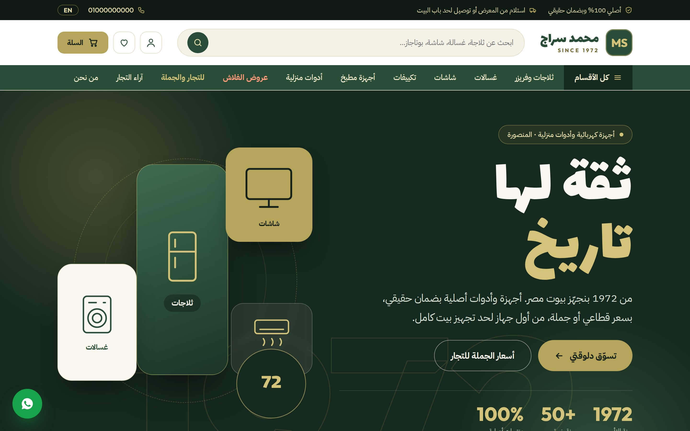
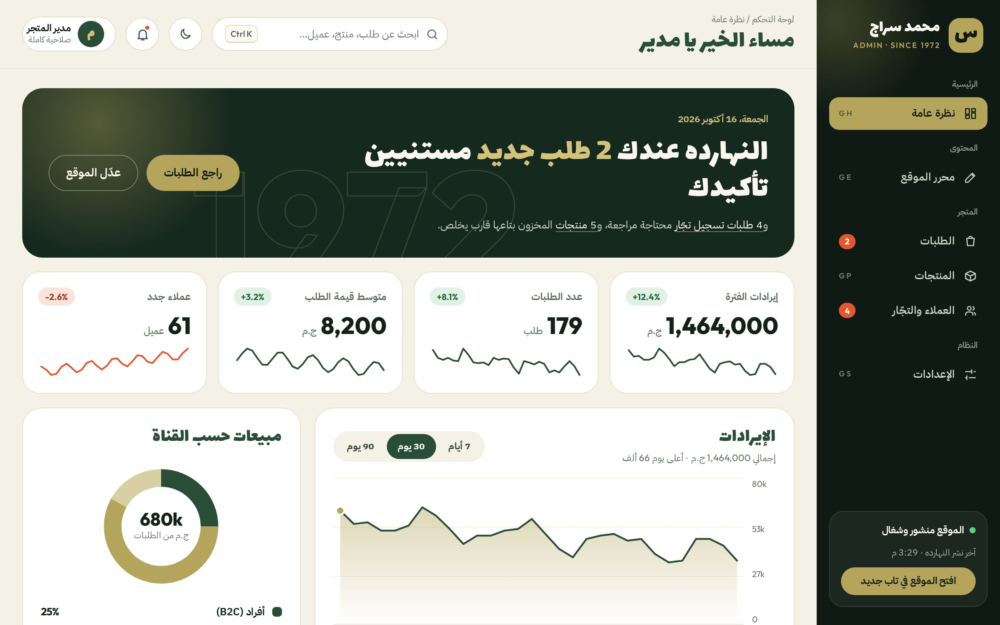
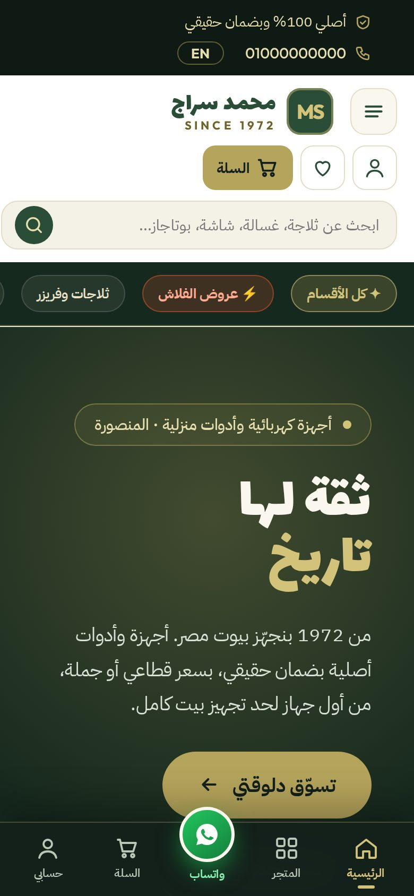
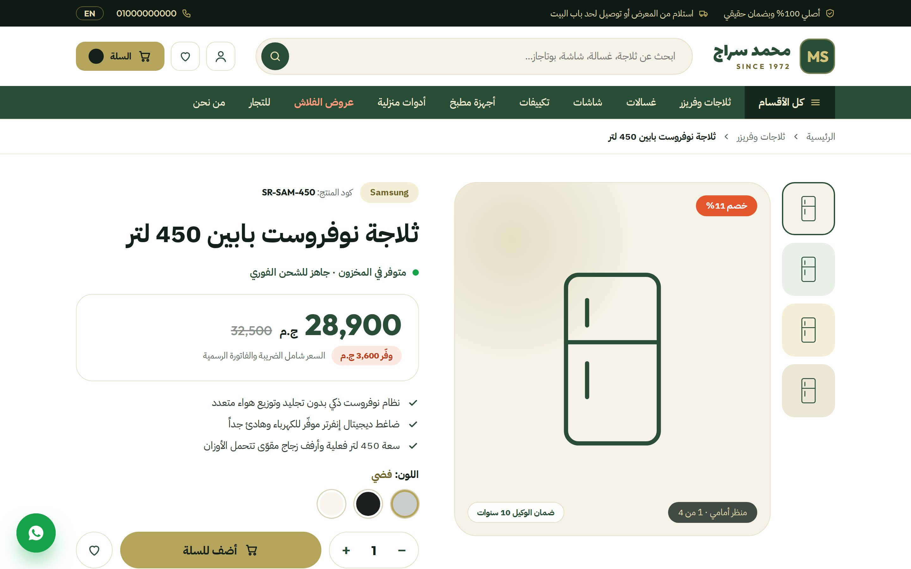
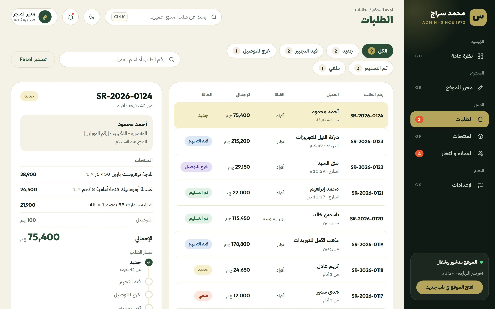
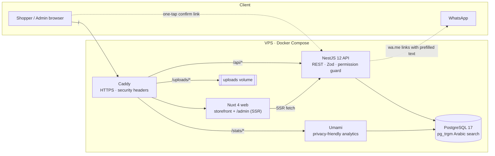
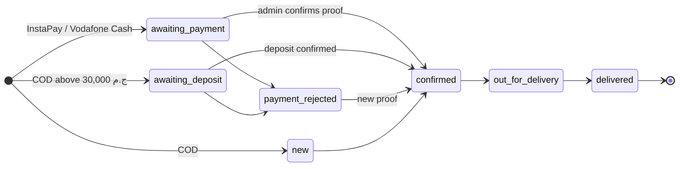

<div align="center">

# Mohamed Serag · معرض محمد سراج

**An Arabic-first online store for a home-appliance showroom in Mansoura, Egypt, family-run since 1972.**
Built around how Egyptians actually buy: WhatsApp, cash on delivery, InstaPay, and furnishing a whole home for a wedding.

[](https://nuxt.com)
[](https://nestjs.com)
[](https://www.postgresql.org)
[](https://www.prisma.io)
[](https://tailwindcss.com)
[](https://www.typescriptlang.org)
[](https://pnpm.io)
[](#design-system)
[](#roadmap)

[Features](#features) · [Screenshots](#screenshots) · [Architecture](#architecture) · [Quick start](#quick-start) · [Testing](#testing) · [Roadmap](#roadmap) · [Docs](#documentation)

</div>

---

## Why this project

Most Egyptian appliance stores sell online through Facebook posts and phone calls. Prices go stale, stock is a guess, and every order turns into a long WhatsApp thread. This project gives the showroom a real store without forcing customers to change how they shop:

- **WhatsApp stays the channel.** Every order, payment proof and status update is one tap away from a prefilled WhatsApp message.
- **Payments people already use.** Cash on delivery, InstaPay and Vodafone Cash. Large cash orders take a small transfer deposit.
- **The wedding season is the business.** A bride's family can build a complete home package room by room, share it, and lock the prices with a deposit.
- **Arabic everywhere.** Right-to-left layouts, Egyptian Arabic copy, and search that understands «تلاجه», «ثلاجة» and «٤٥٠ لتر» as the same thing.

> ملخص: متجر إلكتروني عربي لمعرض أجهزة منزلية في المنصورة، مبني حول الواتساب والدفع عند الاستلام وإنستا باي، ومعاه «جهّز بيتك» — قايمة جهاز العروسة اللي تتعدّل أوضة أوضة وتتثبت أسعارها بعربون.

## Features

<table>
<tr>
<td width="50%" valign="top">

### 🛍️ Storefront
- Categories, brands and product pages with real specs, warranty and delivery cost per zone
- Arabic-aware search (letter folding, Arabic-Indic digits, synonyms, trigram matching)
- Filters synced to the URL, compare up to 3 products, wishlist
- Flash sales with countdowns, old prices, coupons
- Reviews that appear only after admin approval
- Buying guides, landing pages, a «ساعدني أختار» quiz, Google Merchant feed

</td>
<td width="50%" valign="top">

### 💍 «جهّز بيتك» bridal builder
- Start from a tier (أساسية · ذهبية · القصر) and edit room by room
- Share a read-only link on WhatsApp with the family
- Reserve with a 10% deposit that locks prices and the delivery fee for 30 days
- Partial deposits, lock extension and re-pricing from the admin
- Stock is held only once a delivery date is agreed

</td>
</tr>
<tr>
<td valign="top">

### 💳 Checkout & payments
- Guest checkout, Egyptian phone normalization, delivery zones by governorate and city
- Cash on delivery, InstaPay, Vodafone Cash (Fawry pending)
- Cash orders above 30,000 ج.م ask for a 10% deposit
- The customer sends proof on WhatsApp; the admin confirms or rejects with **one tap** from a secure link
- Private order pages behind a public token

</td>
<td valign="top">

### 🧭 Admin dashboard
- Orders, payments, stock movements and WhatsApp templates in one place
- Products with spec templates, live card preview and CSV import
- Homepage CMS with draft, preview, publish and version history
- Command palette (Ctrl/⌘ K), «G ثم حرف» shortcuts, undo toasts, dark mode
- Session auth with CSRF, a permission check on every endpoint, and an audit log

</td>
</tr>
</table>

## Screenshots

The screenshots below are from the **HTML prototype** in [`prototype/`](prototype). It is the design reference the Nuxt app is being built from.

<table>
<tr>
<td colspan="2"><p align="center"><sub>Storefront home</sub></p></td>
</tr>
<tr>
<td width="72%"><p align="center"><sub>Admin overview</sub></p></td>
<td width="28%"><p align="center"><sub>Mobile, 390 px</sub></p></td>
</tr>
<tr>
<td><p align="center"><sub>Product page</sub></p></td>
<td><p align="center"><sub>Admin orders</sub></p></td>
</tr>
</table>

## Architecture



**How an order moves**



## Tech stack

| Layer | Choice | Why |
|---|---|---|
| Web | **Nuxt 4**, Vue 3, Tailwind CSS 4, shadcn-vue (reka-ui), `@nuxt/image`, `@nuxt/fonts`, `@nuxtjs/i18n` | SSR for SEO and fast first paint, RTL-ready components |
| API | **NestJS 12** (ESM, SWC), Zod 4 validation, helmet, throttler | Typed modules, guards and interceptors for permissions and audit |
| Data | **PostgreSQL 17** + **Prisma 7** (`prisma-client`, `@prisma/adapter-pg`) | Relational integrity for orders and money, trigram search for Arabic |
| Shared | `@serag/shared` (normalizers, money, enums, order flow, WhatsApp templates, zones) · `@serag/ui` (brand tokens) | One source of truth for web and API |
| Tooling | pnpm workspaces + catalog, Turborepo, ESLint, oxlint, Prettier, Vitest | Fast, consistent monorepo |
| Testing | Vitest (unit + API against a real test DB), [TesterArmy e2e](https://tester.army/e2e) (Playwright), Lighthouse CI | Every slice ships with browser tests |
| Ops | Docker Compose, Caddy, Umami, GitHub Actions | One small VPS, automatic HTTPS |

Money is always stored as **integer piastres** (`28,900 ج.م` → `2890000`). Exact versions are pinned in [`docs/STACK.md`](docs/STACK.md).

## Project structure

```text
.
├── apps/
│   ├── web/            Nuxt 4 app: storefront + /admin
│   └── api/            NestJS API, Prisma schema, migrations and seed
├── packages/
│   ├── shared/         Zod schemas, Arabic/phone normalizers, money, enums, WhatsApp, zones
│   ├── ui/             Brand tokens (light/dark) for Tailwind 4 + shadcn-vue
│   └── config/         Shared tsconfig and ESLint
├── tests/e2e/          Browser end-to-end tests (TesterArmy e2e)
├── docker/             compose.dev.yml, compose.yml, compose.e2e.yml, Caddyfile, Dockerfiles
├── docs/               PRD, stack guide, README assets
├── specs/              spec-kit specs, plans and task lists per feature
└── prototype/          Original HTML store and admin (design reference)
```

## Quick start

**Prerequisites:** Node.js ≥ 24.8, pnpm 10 (`corepack enable`), Docker.

```bash
git clone https://github.com/ameenmv/mohamedserag_ecommerce.git
cd mohamedserag_ecommerce
cp .env.example .env              # set ADMIN_EMAIL / ADMIN_PASSWORD
pnpm install
pnpm db:setup                     # Postgres in Docker + migrations + Prisma client + demo data
pnpm dev                          # web → http://localhost:3000 · api → http://localhost:4000/api
```

Full step-by-step guide with troubleshooting: **[docs/GETTING-STARTED.md](docs/GETTING-STARTED.md)**.

Open `http://localhost:3000` for the store and `http://localhost:3000/admin` for the dashboard, then sign in with the admin from your `.env`.

<details>
<summary><b>Run the whole stack in Docker</b></summary>

```bash
SESSION_SECRET=$(openssl rand -hex 32) docker compose -f docker/compose.yml up -d --build
```

Caddy serves everything on one origin: `/` (web), `/api` (API), `/uploads` (product images) and `/stats` (Umami).

</details>

<details>
<summary><b>Browse the HTML prototype</b></summary>

```bash
python3 -m http.server 8765 --directory prototype
```

Then open `http://localhost:8765` for the store and `http://localhost:8765/admin/` for the admin.

</details>

## Useful scripts

| Command | What it does |
|---|---|
| `pnpm dev` | Web and API in watch mode |
| `pnpm build` | Build every package and app |
| `pnpm lint` · `pnpm typecheck` | Static checks across the monorepo |
| `pnpm test` | Unit tests in every package |
| `pnpm --filter @serag/api test:e2e` | API tests against the test database |
| `pnpm test:e2e` | Browser end-to-end tests (starts web and API if they are not running) |
| `pnpm db:setup` | Databases + migrations + Prisma client + demo data |
| `pnpm db:up` · `pnpm db:down` | Start or stop the dev databases |
| `pnpm db:migrate` · `pnpm db:seed` · `pnpm db:studio` | Migrate, reseed, browse the data |

## Testing

Each delivery slice is done only when its **independent test** passes in a real browser.

- **Unit:** Vitest in `packages/*` and `apps/*`. Examples: Arabic normalization, phone parsing, money, the order state machine, guards.
- **API:** NestJS boots against a migrated PostgreSQL test database (tmpfs) and runs requests through supertest.
- **End-to-end:** [TesterArmy e2e](https://tester.army/e2e) on Playwright in `tests/e2e`: RTL shell, admin sign-in, checkout journeys, the bridal builder and more as slices land.
- **Quality budgets:** Lighthouse mobile on key pages: performance ≥ 90, accessibility = 100, LCP < 2.5 s, CLS < 0.1.

## Design system

The brand comes from the showroom's 1972 heritage: deep green, antique gold and cream.

| Token | Color | Use |
|---|---|---|
| `serag-night` |  | Admin sidebar, hero backgrounds |
| `serag-green` |  | Primary actions |
| `serag-gold` |  | Accent, focus rings |
| `serag-cream` |  | Page background |
| `serag-hot` |  | Flash sales, alerts |

Type: **Lalezar** for display, **IBM Plex Sans Arabic** for text, **Outfit** for numbers. The tokens live in [`packages/ui/tokens.css`](packages/ui/tokens.css) and support light and dark modes.

## Roadmap

Phase 1 ships in slices. Each slice is usable on its own and covered by e2e tests.

- [x] **Slice 0 — Foundation:** monorepo, web and API, database, seed, admin auth, Docker, CI
- [x] **Slice 1 — Catalog & discovery:** categories, brands, product pages, Arabic search, filters, compare, wishlist, admin products, CSV import
- [x] **Slice 2 — Cart, checkout & payments:** zones, COD, transfers, large-COD deposit, one-tap confirmation, order flow
- [x] **Slice 3 — «جهّز بيتك» bridal builder:** tiers, sharing, deposit and price lock
- [ ] **Slice 4 — Promotions & stock alerts:** flash sales, coupons, notify-me
- [ ] **Slice 5 — Reviews:** moderation and verified buyers
- [ ] **Slice 6 — Content, CMS & SEO:** homepage CMS, guides, quiz, structured data, Merchant feed
- [ ] **Slice 7 — Dashboard, reports & settings**

**Phase 2:** customer accounts, loyalty, an installable app (PWA), the WhatsApp Cloud API, e-receipts, and admin roles.

## How it is built

The project follows [GitHub spec-kit](https://github.com/github/spec-kit): a product requirements document, then a spec, plan and task list per feature under [`specs/`](specs), guided by the [constitution](.specify/memory/constitution.md).

Implementation runs on an AI pair workflow. Claude plans each task and writes a brief, Gemini (through Antigravity) writes the code, and Claude reviews the diff and runs every gate (lint, typecheck, unit, API and browser tests) before anything is committed.

## Documentation

| Document | Contents |
|---|---|
| [`docs/GETTING-STARTED.md`](docs/GETTING-STARTED.md) | Run the project locally, step by step |
| [`docs/PHASE-1.md`](docs/PHASE-1.md) | Phase 1 progress: what is done, in progress and next |
| [`docs/PRD.md`](docs/PRD.md) | Vision, personas, decisions, user stories with acceptance criteria, data model, KPIs |
| [`docs/STACK.md`](docs/STACK.md) | Pinned versions, commands, Docker, telemetry notes |
| [`specs/002-phase1-launch/`](specs/002-phase1-launch) | Phase 1 spec, plan and tasks |
| [`.specify/memory/constitution.md`](.specify/memory/constitution.md) | Project principles |

## Contributing

1. Branch from `main` (`NNN-short-name`, matching a spec under `specs/`).
2. Keep customer-facing copy in Egyptian Arabic and layouts RTL-correct (logical CSS properties only).
3. Validate every API input with Zod, and give every admin endpoint a permission check.
4. Run `pnpm lint && pnpm typecheck && pnpm test` and the relevant e2e tests before opening a pull request.

## License

No open-source license has been chosen yet, so all rights are reserved by the project owner. Please ask before reusing the code or the brand assets.

<div align="center">
<sub>صُنع بعناية للمنصورة 🇪🇬 · Made with care in Mansoura</sub>
</div>
